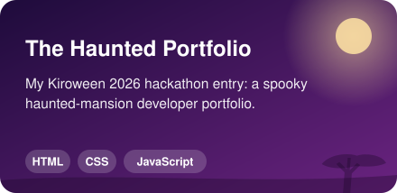
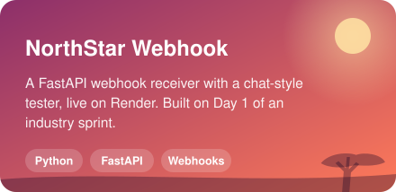
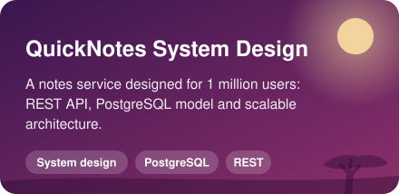
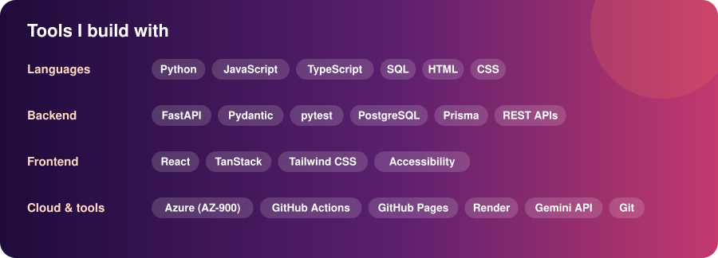
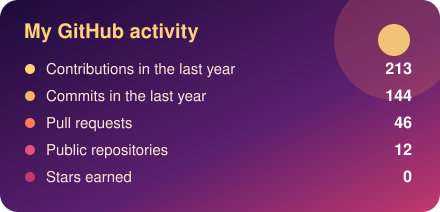

  

  

- 🎓 Software Engineering Student in the **Power Learn Project (PLP) 1MillionDevs** programme
- 🌍 Based in **Nairobi, Kenya**. I speak English and Kiswahili
- 🌱 Currently learning **Azure (AZ-900)**, **system design** and **fair, human-centred AI**
- 📫 Say hello: **kamandewanjiku60@gmail.com**

  

<table>
<tr>
<td width="50%" align="center">
 
<a href="https://wanjikuk60.github.io/AZ-900-Study-Buddy/"><b>Live site</b></a> · <a href="https://github.com/WanjikuK60/AZ-900-Study-Buddy">Code</a>
</td>
<td width="50%" align="center">
 
<a href="https://wanjikuk60.github.io/savannah-loan-system/"><b>Live site</b></a> · <a href="https://github.com/WanjikuK60/savannah-loan-system">Code</a>
</td>
</tr>
<tr>
<td width="50%" align="center">
 
<a href="https://wanjikuk60.github.io/Kiroween/"><b>Live site</b></a> · <a href="https://github.com/WanjikuK60/Kiroween">Code</a>
</td>
<td width="50%" align="center">
 
<a href="https://wanjikuk60.github.io/northstar-day1-webhook/"><b>Live site</b></a> · <a href="https://github.com/WanjikuK60/northstar-day1-webhook">Code</a>
</td>
</tr>
<tr>
<td width="50%" align="center">
 
<a href="https://wanjikuk60.github.io/quicknotes-system-design/"><b>Live site</b></a> · <a href="https://github.com/WanjikuK60/quicknotes-system-design">Code</a>
</td>
<td width="50%" align="center">
 
<a href="https://wanjikuk60.github.io/Solstice-Kiosk/"><b>Live site</b></a> · <a href="https://github.com/WanjikuK60/Solstice-Kiosk">Code</a>
</td>
</tr>
<tr>
<td width="50%" align="center">
 
<a href="https://wanjikuk60.github.io/quicknotes-app/"><b>Live site</b></a> · <a href="https://github.com/WanjikuK60/quicknotes-app">Code</a>
</td>
<td width="50%" align="center">
 
<a href="https://wanjikuk60.github.io/Chat-Cartographer/"><b>Live site</b></a> · <a href="https://github.com/WanjikuK60/Chat-Cartographer">Code</a>
</td>
</tr>
</table>

  

  

  

  
  

  

  <picture>
    <source media="(prefers-color-scheme: dark)" srcset="https://raw.githubusercontent.com/WanjikuK60/WanjikuK60/output/sunset-snake-dark.svg"/>
    
  </picture>

  

