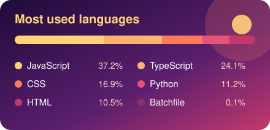

  

  

  

  
  

  

  
  

  
  

  
  

  
  

Click a card to open its live site · Source code: <a href="https://github.com/WanjikuK60/AZ-900-Study-Buddy">AZ-900 Study Buddy</a> · <a href="https://github.com/WanjikuK60/savannah-loan-system">Savannah Loan System</a> · <a href="https://github.com/WanjikuK60/Kiroween">The Haunted Portfolio</a> · <a href="https://github.com/WanjikuK60/northstar-day1-webhook">NorthStar Webhook</a> · <a href="https://github.com/WanjikuK60/quicknotes-system-design">QuickNotes System Design</a> · <a href="https://github.com/WanjikuK60/Solstice-Kiosk">Solstice Kiosk</a> · <a href="https://github.com/WanjikuK60/quicknotes-app">QuickNotes</a> · <a href="https://github.com/WanjikuK60/Chat-Cartographer">Chat Cartographer</a>

  

  
  
  
  
  
  
  
  
  
  
  
  
  
  
  
  
  
  
  
  

  

  
  

  

  

  <picture>
    <source media="(prefers-color-scheme: dark)" srcset="https://raw.githubusercontent.com/WanjikuK60/WanjikuK60/output/sunset-snake-dark.svg"/>
    
  </picture>

  

  

